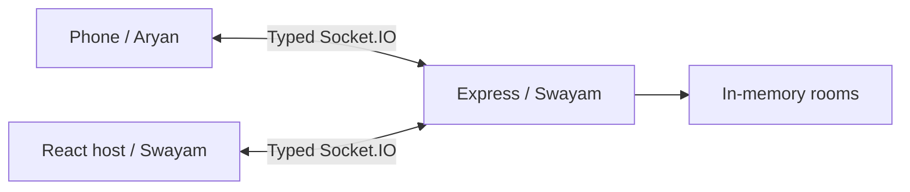

# Crownfall

A 4–8 player motion party game. Aryan owns phone controls, sensors, audio and deployment. Swayam owns the authoritative server and host display.

Phase 0 provides a runnable room-server scaffold. Gameplay, ready/start, resume, QR codes and Phaser rendering are later gated deliverables; they are not implemented yet.

Requires Node.js 20+ and npm.

```sh
npm ci
npm run dev
```

Open http://localhost:5173/host. Vite proxies Socket.IO and `/health` to port 3000. The controller and sensor routes are explicit placeholders outside Aryan's owned folders.

```sh
npm run typecheck
npm test
npm run build
npm start
```

Production listens on `PORT` (default 3000), serves `dist/client`, SPA routes and Socket.IO on one origin. Set `PUBLIC_ORIGIN=https://your-host.example` (no trailing slash) for correct join links; during Vite development use `PUBLIC_ORIGIN=http://localhost:5173`. TLS termination and provider configuration belong to Aryan. `/health` returns JSON. Rooms are in memory and disappear on restart. The prototype has no durable cleanup or resume yet; do not use it as a public production game server.



See [integration contract and handoff](docs/INTEGRATION.md). Contract v0 is proposed for teammate review, not yet mutually frozen. Do not begin the next phase until Gate 0 is confirmed.

Package credits: [Express](https://expressjs.com/), [Socket.IO](https://socket.io/), [React](https://react.dev/), [Vite](https://vite.dev/), [TypeScript](https://www.typescriptlang.org/), [tsx](https://tsx.is/), [concurrently](https://github.com/open-cli-tools/concurrently), and DefinitelyTyped type packages. Phaser and qrcode will be introduced with the host arena phase. Project license: [MIT](LICENSE).
