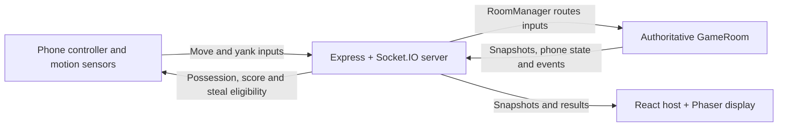

# CrownFall

**One shared screen. A room full of rivals. Your phone is the controller.**

CrownFall is a multiplayer motion-controlled party game built for HackPSU's Mystery Stack challenge: phone motion, rivalry, and a group of four or more. Tilt your phone to move your avatar, collect the crown, and yank to steal it from another player. Earn the most points during a **90-second round** to win.

The current game supports **2–8 players**, with **4+ players** as the intended hackathon group demo. Phase 3 gameplay is implemented and merged into `main`. See [Phase 3 integration notes](server/PHASE3.md) for protocol details and verification status.

[Phase 4 draw-off duels](server/PHASE4.md) provide opt-in server/host integration code. The flag is **disabled by default**; phone duel/stillness integration and contract approval remain outstanding. The default game below continues to use Phase 3 direct stealing.

## What you can play today

- Create a room on the big screen and join from phones using its QR code or link.
- Enable mobile motion sensors, calibrate, and tilt to move independently in a shared arena.
- Collect the authoritative crown, earn possession points, and feel the holder's movement slow down over time.
- Steal with a motion-triggered yank, subject to server distance checks, cooldowns and immunity.
- Follow the live scoreboard, crown highlights, event banners and round timer on the host display.
- Finish a 90-second round with final rankings, a winner screen and support for tied winners.
- Start a rematch with the same connected phones; players ready up again in the lobby.
- Automatically reclaim disconnected lobby players' slots after two seconds, preserving unique player colors.

## How to play

1. **Create and join.** Open `/host` on a computer connected to the shared screen. Create a room, then scan its QR code on each phone and enter a name. Joining is available during the lobby.
2. **Calibrate.** Tap **Enable Motion** and allow sensor access. Hold your phone flat-ish, screen up, in your playing position; keep it still and tap **Calibrate**. Test the tilt dot, then tap **I'm ready**. You can recalibrate if needed.
3. **Start and move.** Once at least two connected players are ready, the host can start. Tilt to warm up in the lobby; movement pauses for the three-second countdown, then the 90-second round begins.
4. **Collect the crown.** Move within 35 arena units of the unheld crown, which begins at the center. The nearest connected player collects it; equal-distance pickups use a stable player-ID ordering.
5. **Hold to score.** Each uninterrupted connected possession earns **1 point per 500 ms**. Fractional possession time resets on transfer or drop. Normal movement speed is 210 arena units/second. Holders start at 175, lose 3 units/second of speed for each second held, and bottom out at 130.
6. **Yank to steal.** Approach within 85 arena units of the holder. When your phone says **YANK NOW**, make a deliberate yank. A valid steal transfers the crown and awards **3 points**. The new holder gets **2 seconds of immunity**. An otherwise eligible in-range attempt starts a **2.5-second challenger cooldown**, including one blocked by immunity. Initial pickup has no immunity; the server decides eligibility and resolves competing yanks in receipt order.
7. **Win and rematch.** At the deadline, movement and scoring stop. All players tied for the highest score win. The host selects **Rematch – return to lobby**; scores, crown, positions and readiness reset while connections and player identities remain. Tap **I'm ready** again, then the host starts the next round.

A disconnected holder stops scoring immediately and drops the crown after two seconds during play. Active-round players remain in the roster and final results. Lobby disconnects instead free their slots after two seconds; offline players carried into a rematch receive that lobby grace period on reset.

## Technology and architecture

TypeScript throughout, with **React + Vite** for browser interfaces, **Node.js + Express + Socket.IO** for the server, **Phaser 3** for the arena, and mobile device orientation/motion sensors for phone controls.

The gameplay path is **Phone Controller → Socket.IO Server → Authoritative GameRoom → Phaser Host Display**. Phones send intentions; the server owns positions, crown possession, scores, eligibility and round timing. The host interpolates visual positions and displays the server's decisions.



| Area | Responsibility |
| --- | --- |
| `client/controller/` | Permissions, calibration, tilt/yank detection, clock synchronization and phone screens |
| `server/RoomManager.ts` | Isolated in-memory rooms, capacity, readiness, host authorization and lobby cleanup |
| `server/GameRoom.ts`, `server/scoring.ts` | Fixed-step movement, crown, validated steals, elapsed-time scoring, round deadlines and rankings |
| `server/app.ts` | HTTP routes, socket membership, input routing and broadcasts |
| `client/host/` | Room creation, QR joining, Phaser arena, scoreboard, results and rematch control |
| `shared/` | Typed Socket.IO contract and gameplay constants |

### Update rates

| Component | Current configuration |
| --- | --- |
| Server simulation | 30 Hz |
| Snapshot broadcasts | Approximately 30 Hz |
| Phone movement inputs | 20 Hz |
| Host interpolation | 50 ms behind snapshot receipt |

These are implementation settings, not measured end-to-end latency guarantees. Periodic broadcasts publish new simulation ticks without duplicating unchanged ticks; roster, phase and gameplay events can trigger updates. The server clamps movement axes, normalizes diagonals, enforces arena boundaries and stops movement after 250 ms without fresh valid input. Scoring and deadlines use monotonic elapsed time rather than snapshot counts. The host does not predict authoritative movement or possession.

## Run locally

Requires **Node.js 20+** and npm.

```sh
npm ci
npm run dev
```

Open [localhost:5173/host](http://localhost:5173/host). The development command runs Vite on port 5173 and the Node server on port 3000. Vite proxies `/socket.io` (including WebSocket upgrades) and `/health` to the server. Keep the development server on port 3000 unless you also adjust the proxy configuration.

| Route | Purpose |
| --- | --- |
| `/host` | Shared-screen host, lobby and arena |
| `/play/:roomCode` | Phone controller; replace `:roomCode` with the five-character room code |
| `/sensor-test` | Motion sensor diagnostics |
| `/health` | Server health JSON |

For physical phones, open a reachable host URL before displaying its QR code: `localhost` on a phone refers to that phone. Vite listens on the network, but mobile motion permissions require a secure context. Use a trusted HTTPS development endpoint or the team's HTTPS deployment; a plain LAN HTTP URL is not sufficient for the controller's motion-permission flow.

Run the quality gates and build before starting the production server:

```sh
npm run typecheck
npm test
npm run build
npm start
```

The build writes the client to `dist/client` and server to `dist/server`. Production serves frontend routes, `/health` and Socket.IO from one persistent Node process; the default host URL is `http://localhost:3000/host`.

### Deployment configuration

Use a persistent Node service with HTTPS termination and WebSocket support. This README does not certify which revision is currently deployed.

| Variable | Usage |
| --- | --- |
| `PORT` | Server listening port; defaults to `3000`. Use the port supplied by the hosting provider. |
| `PUBLIC_ORIGIN` | Set to the public HTTPS origin for shared/deployed use, without a path or trailing slash, e.g. `https://your-app.example`. Used for canonical `room:create` join links; omitted values fall back to localhost. For desktop development, `http://localhost:5173` matches Vite. |
| `NODE_VERSION` | Hosting-provider runtime selection, where supported; the team's Render configuration uses `20`. The application itself requires Node.js 20+ through `package.json`. |

Host QR codes use the current browser origin. No database or API credentials are required by the current implementation. Rooms live in one process and disappear on restart; distributed room persistence is not implemented.

## Testing and verification status

`npm test` runs the **29 Phase 3 regression tests** plus opt-in Phase 4 tests using Node's test runner through `tsx`. Phase 3 coverage includes:

- Deterministic crown pickup, contested pickups, 500 ms scoring, slowdown and delayed disconnect drops.
- Yank validation, epoch timestamps, per-event sequence/replay checks, out-of-order inputs, authoritative range, cooldowns, immunity and competing challengers.
- Round deadlines, final scores, tied winners, one result per round, connected rematches and correct event ordering when ending/resetting in one update.
- Actual Socket.IO clients for complete rounds/rematches, four independent moving players, eight-player capacity, room isolation, readiness and host authorization.
- Snapshot cadence, 50 ms interpolation, crown attachment, lobby cleanup, reusable slots, unique colors, input expiry and server disposal.

Controllable clocks advance full-round tests without waiting 90 seconds. These network clients exercise the protocol; they do not emulate physical phone motion sensors.

An optional browser smoke test serves the built client through the application server and launches headless Microsoft Edge:

```sh
npm run build
npm run test:host
```

It checks QR joining, the two-player readiness minimum, four moving socket clients, one Phaser canvas, pickup/steal banners, scoreboard, timer, winners, rematch and responsive layout. It advances an injected server clock for the round ending and saves screenshots under ignored `dist/verification/`. Edge must be installed, or set `CROWNFALL_BROWSER_EXECUTABLE` to a Chromium-family browser executable; `playwright-core` does not download a browser. This check passed during Phase 3 implementation.

Physical-device verification is tracked separately:

- **Phase 2:** tested on four real iPhones.
- **Phase 3:** Aryan reviewed the code and explicitly approved the rematch semantics. Aryan's agent reported successful end-to-end rounds with two phone controllers, covering pickup, stealing, the 90-second ending and rematch.
- **Remaining gate:** the final four-physical-phone Phase 3 test on the deployed version is **not yet independently confirmed**. A successful local build or automated test does not establish that deployment result.

## Limitations and future work

The playable default Phase 3 loop uses direct stealing. Draw-off duels require completion of the [Phase 4 phone integration](server/PHASE4.md) before production use. Revenge mechanics, vault gems, Last Stand, announcer support and advanced audiovisual polish remain future work. Reserved constants and event types for those features do not mean they are active.

Reconnect/resume and host refresh recovery are not implemented. A host connection loss requires creating a new room after reconnecting. Unoccupied rooms expire after 60 seconds. Phone feedback currently labels an unavailable yank as “Too far,” including cooldown/immunity, and its ordinal tied-rank display can differ from the host's shared ranks; every tied winner is still included in the server's `winnerIds`. Sensor permissions and haptic support vary by device/browser. The Phaser bundle is loaded when a host room opens and still produces a large-chunk build warning.

## Team, credits and license

**Aryan:** phone controller, sensors, audio and deployment. **Swayam:** authoritative backend, big-screen host and server/host verification.

Package credits: [Express](https://expressjs.com/), [Socket.IO](https://socket.io/), [React](https://react.dev/), [Vite](https://vite.dev/), [TypeScript](https://www.typescriptlang.org/), [Phaser 3](https://phaser.io/), [qrcode](https://github.com/soldair/node-qrcode), [Playwright](https://playwright.dev/), [tsx](https://tsx.is/), [concurrently](https://github.com/open-cli-tools/concurrently), and DefinitelyTyped type packages. Dependencies retain their respective licenses.

CrownFall is licensed under the [MIT License](LICENSE), copyright © 2026 SwayamKandoi.
