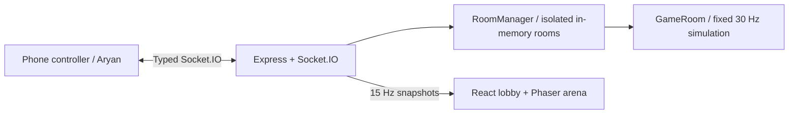

# Crownfall

A motion-controlled party game for 4–8 players. Aryan owns the phone controller, sensors, audio and deployment; Swayam owns the authoritative server and big-screen host.

Phases 1–2 provide a multiplayer movement foundation: rooms, readiness, host authorization, a three-second countdown, authoritative movement, QR lobby and an interpolated Phaser arena. Crown mechanics, scoring and full rounds belong to later gates. The crown in the arena is decorative.

Requires Node.js 20+ and npm.

```sh
npm ci
npm run dev
```

Open http://localhost:5173/host. Vite proxies Socket.IO and /health to port 3000. Aryan's /sensor-test page is preserved. /play/:roomCode remains the existing placeholder until Aryan connects the controller through the shared router; no new phone controller was implemented.

```sh
npm run typecheck
npm test
npm run build
npm start
```

Production serves frontend routes and Socket.IO from one persistent Node server, listening on PORT (default 3000). Set PUBLIC_ORIGIN to the deployed HTTPS origin without a trailing slash for canonical room:create join links. Host QR codes use the current browser origin. Aryan owns TLS termination and provider configuration.

The server advances fixed simulation steps at 30 Hz and sends snapshots at approximately 15 Hz. Players send intentions at 20 Hz; the server clamps axes, normalizes diagonal speed, enforces boundaries, rejects stale sequence numbers and stops movement after 250 ms without valid input. Lobby free movement is available; countdown pauses movement. The renderer interpolates positions about 100 ms behind snapshot receipt and never calculates scores or player decisions.



Run `npm test` for deterministic game tests, Socket.IO simulations of four/eight players and isolated rooms, authorization/countdown tests and interpolation tests. No physical phones are required.

Optional production browser verification uses the existing Microsoft Edge browser:

```sh
npm run build
npm run test:host
```

The browser smoke check starts and stops its own production server, joins four simulated players, checks QR/canvas/readiness/countdown/movement/disconnect and saves screenshots to dist/verification. It needs Microsoft Edge installed; alternatively set CROWNFALL_BROWSER_EXECUTABLE to a Chromium-family browser executable. playwright-core does not download browsers. The large Phaser chunk is loaded only when a host room opens.

See [integration handoff](docs/INTEGRATION.md) for exact protocol usage, controller hookup, four-phone verification and remaining proposals. Resume and host refresh recovery are explicitly NOT_IMPLEMENTED. Disconnected players remain in their slots; unoccupied rooms expire after 60 seconds. State disappears on server restart. Real-device and deployed-HTTPS gates still require Aryan.

Package credits: [Express](https://expressjs.com/), [Socket.IO](https://socket.io/), [React](https://react.dev/), [Vite](https://vite.dev/), [TypeScript](https://www.typescriptlang.org/), [Phaser 3](https://phaser.io/), [qrcode](https://github.com/soldair/node-qrcode), [Playwright](https://playwright.dev/), [tsx](https://tsx.is/), [concurrently](https://github.com/open-cli-tools/concurrently), and DefinitelyTyped type packages. Project license: [MIT](LICENSE).

Phase 3 may begin only after the joint four-player movement gate is approved.
